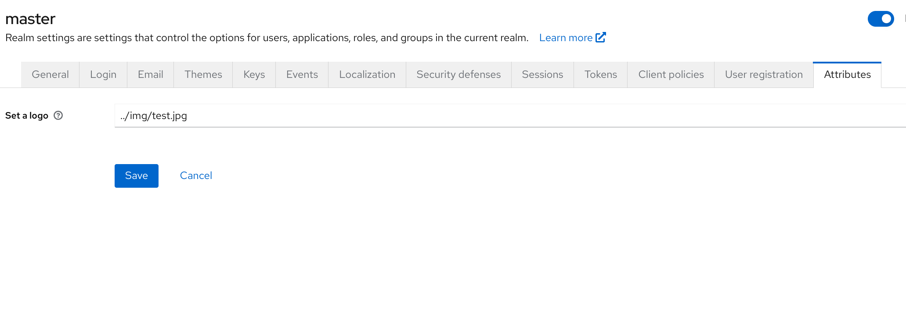
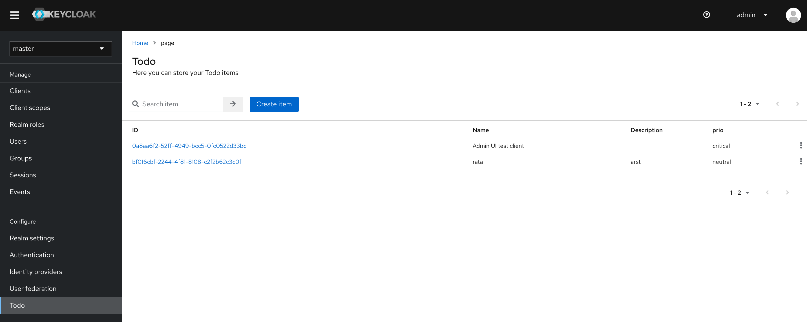
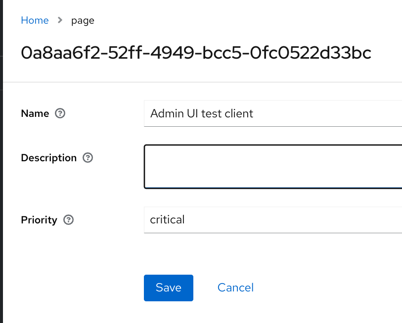

## Extending the admin ui with SPI

This example shows how you can extend the admin ui by implementing the SPI.
You can add a tab to an existing page, a complete section with a declarative form, or a nav item backed by a custom JavaScript module.
By implementing either:

  * `org.keycloak.services.ui.extend.UiPageProvider` for a complete section (declarative form / CRUD)
  * `org.keycloak.services.ui.extend.UiTabProvider` for a tab
  * `org.keycloak.services.ui.extend.UiScriptProvider` for a nav item that loads a custom ES module

For `UiPageProvider` and `UiTabProvider` you describe the fields with `org.keycloak.provider.ProviderConfigProperty`.
To specify where the tab will appear in the ui, you can add a path; valid paths can be found in the `routes.ts` files in the admin-ui module of the Keycloak project.

For `UiScriptProvider`, implement `getUrl()` so it returns the URL of an ES module. The module must `export default` a function that receives `{ realm, i18n, adminClient }` and returns an `HTMLElement`. Serve the module from `theme-resources/resources/` in the provider JAR (see [Theme resource provider](https://www.keycloak.org/ui-customization/themes)).

This example contains:

  * `AdminUiPage` — a Todo section in the side menu (list / create / edit)
  * `ThemeUiTab` — an extra tab in Realm settings to edit realm attributes
  * `AdminUiScript` — a Hello nav item that mounts `content/hello-realm.js`

### Running

Run this example by compiling with maven:

```bash
mvn -Pextension clean install -DskipTests=true
```

Then copy the generated `extend-admin-ui.jar` into your <keycloak-server>/providers folder and run the server using:

```bash
kc.[sh|bat] start-dev --features=declarative-ui
```

NOTE: In order to properly use the SPI, the `declarative-ui` feature must be turned on.

### Screenshots

To illustrate how `getPath` method is used, check the `ThemeUiTab` class in this quickstart. The ThemeUi page can now be found when you navigate to _Realm settings_.


The `AdminUiPage` class illustrates how to introduce a new section into the main menu in admin console. It adds a Todo section as the last item in the side menu:


After you created an item you can view the details by clicking on it in the list:


The `AdminUiScript` class adds a **Hello** item under Configure. Clicking it dynamically imports the ES module and mounts the returned DOM element. The module can use the realm name, i18n, and the admin REST client.

### Integration test of the Quickstart
Make sure you have a Keycloak server running with an admin user in the master realm and copy the generated jar file into the providers folder.
Your Keycloak server should be listening on `http://localhost:8180`. You can achieve this by running:
```
./kc.sh start-dev --http-port=8180 --features=declarative-ui
```

You need to have Chrome browser installed and updated to the latest version. See the root README for additional details.
```
mvn clean install -Dextension
```

### Undeploy the quickstart
Remove the `extend-admin-ui.jar` from your providers folder and restart the server.